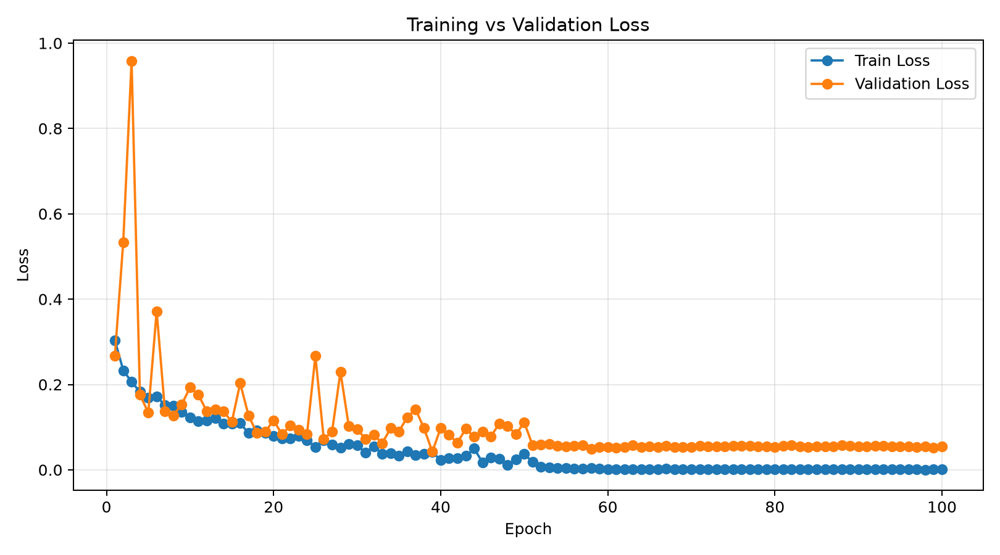
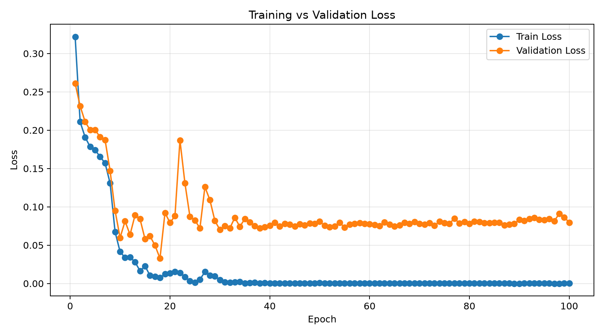

# Pediatric Chest X-ray Pneumonia Classification

**Project Status: Completed — 실험 및 분석 종료**

소아 흉부 X-ray에서 `NORMAL`과 `PNEUMONIA`를 분류하는 ResNet-50을 학습하고, **Scratch 학습과 ImageNet 사전학습 기반 Transfer Learning**을 비교했다. 두 학습 방식에서 최종 분류 성능뿐 아니라 Validation 성능의 수렴 양상과 Grad-CAM++의 공간적 반응 패턴이 어떻게 달라지는지 확인하는 것이 목적이었다.

초기 Scratch 모델에서 높은 Validation F1이 관찰된 뒤에는 데이터 분할과 중복 이미지부터 점검했다. 이를 바탕으로 최종 데이터 분할을 구성하고, 각 방식의 하이퍼파라미터를 탐색한 후 Validation F1으로 대표 모델을 선정했다. 선정된 모델은 별도의 내부 Test set에서 평가했으며, Grad-CAM++로 동일한 영상에 대한 반응 영역을 비교했다.

## 핵심 결과

최종 비교에 사용한 모델은 Scratch `exp_008`과 Transfer Learning `exp_003`이다. 두 모델은 동일한 ResNet-50 구조, 데이터 분할, 평가 절차를 사용했다.

| 항목 | Scratch (`exp_008`) | Transfer Learning (`exp_003`) |
| --- | ---: | ---: |
| Best Validation F1 (PNEUMONIA) | 0.9884 | 0.9919 |
| T95 도달 epoch | 4 | 5 |
| T97 도달 epoch | 12 | 9 |
| T99 도달 epoch | 51 | 12 |
| Test Accuracy | 0.9761 | 0.9607 |
| Test PNEUMONIA Recall | 0.9836 | 0.9719 |
| Test PNEUMONIA F1 | 0.9836 | 0.9730 |
| Test NORMAL Recall (Specificity) | 0.9557 | 0.9304 |
| Test NORMAL F1 | 0.9557 | 0.9274 |
| Test Macro F1 | 0.9697 | 0.9502 |
| Test AUROC (PNEUMONIA) | 0.9951 | 0.9956 |
| Test 오분류 | 14 / 585 | 23 / 585 |

**결과를 정리하면 다음과 같다.**

- Transfer Learning은 T95에서 Scratch와 유사한 도달 시점을 보였고, T97과 T99에서는 더 이른 epoch에 해당 기준을 충족했다. 특히 T99는 12 epoch와 51 epoch로 차이가 컸다.
- 내부 Test에서는 Scratch가 Accuracy와 PNEUMONIA F1에서 더 높은 값을 기록했다. 두 모델의 AUROC는 약 0.995로 비슷했다.
- 다수 클래스인 PNEUMONIA뿐 아니라 NORMAL 기준으로 계산해도 Scratch의 F1이 높았다. 클래스별 지표와 오분류 유형은 [내부 Test 평가](#5-내부-test-평가)에 정리했다.
- Grad-CAM++에서는 일부 영상에 대해 Scratch가 영상 경계와 padding 인접 영역까지 넓게 반응했고, Transfer Learning은 상대적으로 흉곽 내부의 제한된 영역에 반응하는 사례가 관찰됐다.

### 대표 학습 곡선

| Scratch `exp_008` | Transfer Learning `exp_003` |
| --- | --- |
|  |  |

### Grad-CAM++ 비교 이미지

아래 두 그림은 동일한 Test 영상에 대해 입력 영상, Scratch CAM, Transfer Learning CAM을 비교한 결과다. 하나는 정상, 다른 하나는 폐렴 영상이며 두 모델 모두 정답을 예측한 사례다.

**NORMAL — `IM-0223-0001.jpeg`**


**PNEUMONIA — `person3_virus_16.jpeg`**


Grad-CAM++는 내부 Test에서 NORMAL 10장과 PNEUMONIA 10장, 총 20장을 클래스 균형 무작위 추출(`seed=123`)하여 수행했다. 위 이미지는 그중 각 클래스를 보여주는 예시로 선택했다. 세 번째 비교 이미지, 각 사례의 예측 정보와 전체 20장에 대한 실행 기록은 [Grad-CAM++ 분석](docs/gradcam_analysis.md) 및 [manifest](docs/assets/gradcam/manifest.json)에 정리했다.

---

## 1. 데이터셋과 분할

원본 데이터는 Kaggle의 [Chest X-Ray Images (Pneumonia)](https://www.kaggle.com/datasets/paultimothymooney/chest-xray-pneumonia)이다. `NORMAL` 1,583장, `PNEUMONIA` 4,273장으로 총 5,856장이며, 원본 Train/Validation/Test는 각각 5,216장, 16장, 624장으로 구성돼 있다.

원본 Validation 이미지가 16장에 불과해 모델 선택용 평가 집합으로 사용하기에는 크기가 작다고 판단했다. 따라서 원본 이미지 전체를 대상으로 새로운 Train/Validation/Test 분할을 생성했다.

분할 과정에서는 동일한 식별자 패턴이 여러 이미지에 반복된다는 점을 이용했다.

```text
PNEUMONIA: person숫자 → PNEUMONIA_PERSON숫자
NORMAL:    IM-숫자   → NORMAL_IM-숫자
```

파일명에서 추출한 `filename-derived group ID`를 그룹으로 사용하고, 다음과 같이 분할했다.

```text
StratifiedGroupKFold(n_splits=10, shuffle=True, random_state=42)
Fold 0~7: Train
Fold 8:   Validation
Fold 9:   Test
```

그룹 단위로 분할해 같은 ID가 Train, Validation, Test에 동시에 포함되지 않도록 했다. 이 ID는 데이터셋에서 제공하는 공식 환자 식별자가 아니라 파일명에서 추출한 값이다.

### 데이터 중복 검사와 최종 분할

초기 Scratch 모델의 Validation F1이 높게 나온 뒤, 중복 이미지가 평가에 영향을 주는지 확인했다. SHA-256으로 동일 파일을 검사하고 pHash로 시각적으로 유사한 교차 분할 이미지의 후보를 탐색했다.

SHA-256 검사에서 다음 두 파일이 동일한 이미지로 확인됐다.

```text
NORMAL2-IM-0096-0001.jpeg
NORMAL2-IM-0095-0001.jpeg
```

원본 데이터셋은 그대로 두고 `NORMAL2-IM-0095-0001.jpeg` 한 장을 실험 대상에서 제외했다. 이후 5,855장을 대상으로 그룹 기반 분할을 다시 생성했다.

| Split | 전체 | NORMAL | PNEUMONIA | Group 수 |
| --- | ---: | ---: | ---: | ---: |
| Train | 4,684 | 1,266 | 3,418 | 2,233 |
| Validation | 586 | 158 | 428 | 279 |
| Test | 585 | 158 | 427 | 278 |
| **합계** | **5,855** | **1,582** | **4,273** | **2,790** |

최종 분할에 대해 다시 확인한 결과는 다음과 같다.

| 점검 항목 | 결과 |
| --- | ---: |
| 서로 다른 Split 사이 filename-derived group 중복 | 0 |
| 서로 다른 Split 사이 SHA-256 동일 파일 그룹 | 0 |
| pHash Hamming distance 0 후보 | 0 |
| pHash Hamming distance 2 후보 | 2쌍 |
| pHash Hamming distance 4 후보 | 74쌍 |

pHash 거리 2·4에 해당하는 후보는 이미지를 직접 비교했고, 동일 이미지로 판단되는 사례는 추가로 발견되지 않았다. pHash는 유사 영상의 검토 대상을 좁히는 용도로 사용했다.

이후 Clean Split에서 Scratch 모델을 다시 학습했을 때도 높은 Validation 성능이 관찰됐다. 따라서 초기의 중복 이미지 한 쌍이 높은 Validation F1의 주된 원인이라고 판단하지는 않았다.

최종 실험에 사용한 이미지 목록과 분할은 [`data/splits/group_split.csv`](data/splits/group_split.csv)에 저장했다. 분할 생성 스크립트는 파일 탐색 순서에 영향을 받을 수 있으므로 기존 실험을 확인할 때는 이 CSV를 기준으로 한다. 중복 발견부터 재분할 및 후보 검토 과정은 [데이터 무결성 검증 기록](docs/data_integrity_audit.md)에 자세히 정리했다.

## 2. 전처리 및 모델

### 전처리

Scratch와 Transfer Learning에 동일한 데이터 전처리를 적용했다. 원본 X-ray의 종횡비를 유지한 채 224×224로 크기를 맞추고 남는 부분은 검은색으로 padding했다.

```text
Train
Grayscale (1채널)
→ 종횡비 유지 Resize 및 Zero Padding (224×224)
→ Random Rotation (±10°, fill=0)
→ Grayscale (3채널)
→ ToTensor
→ ImageNet Normalize

Validation / Test
Grayscale (1채널)
→ 종횡비 유지 Resize 및 Zero Padding (224×224)
→ Grayscale (3채널)
→ ToTensor
→ ImageNet Normalize
```

ImageNet 정규화에는 `mean=[0.485, 0.456, 0.406]`, `std=[0.229, 0.224, 0.225]`를 사용했다. Train에서만 회전을 적용했고, Horizontal Flip은 적용하지 않았다. 전처리의 정확한 순서는 [`src/data/transforms.py`](src/data/transforms.py)에 있다.

### 모델

두 방식 모두 출력이 2개인 ResNet-50으로 이진분류를 수행했다.

| 항목 | Scratch | Transfer Learning |
| --- | --- | --- |
| Backbone | ResNet-50 | ResNet-50 |
| 초기 가중치 | `weights=None` | `IMAGENET1K_V2` |
| 초기 학습 | 전체 모델 학습 | FC-only 7 epoch |
| 이후 학습 | 전체 모델 학습 유지 | 8 epoch부터 전체 Fine-tuning |

Transfer Learning은 사전학습 backbone을 고정한 상태에서 FC 분류기만 7 epoch 동안 학습한 뒤 전체 모델의 가중치를 갱신했다. 이 두 단계의 학습 구성이 최종 Scratch 학습과 다른 조건 중 하나다.

## 3. 실험 설계 및 대표 모델 선택

### 하이퍼파라미터 탐색

최종 비교에 앞서 Scratch에서는 서로 다른 학습률에 대한 탐색을 진행했고, Transfer Learning에서는 FC-only 기간을 결정하기 위한 pilot을 수행했다. 초기 Scratch 실험의 설정에는 `1e-3`, `5e-4` 학습률도 기록돼 있다. 초기 탐색 기록은 `experiments/scratch/exp_001`~`exp_007`, Transfer pilot은 `experiments/transfer/pilot_fc_freeze/`에서 확인할 수 있다.

최종 비교는 두 방식에서 각각 Learning Rate와 Weight Decay를 조합한 **2×2 탐색**으로 구성했다. 공통 학습 설정은 다음과 같다.

```text
Architecture      ResNet-50 (2 classes)
Optimizer         AdamW
Batch size        32
Epochs            100
Training seed     42
Loss              CrossEntropyLoss
Scheduler         ReduceLROnPlateau
Monitor           Validation loss
Factor            0.1
Patience          10
Minimum LR        1e-6
Positive class    PNEUMONIA
```

| 방식 | 실험 | LR | Weight Decay | Best Validation F1 | Best Epoch |
| --- | --- | ---: | ---: | ---: | ---: |
| Scratch | **exp_008** | 1e-4 | 1e-3 | **0.9884** | 68 |
| Scratch | exp_009 | 1e-4 | 1e-2 | 0.9837 | 92 |
| Scratch | exp_010 | 5e-5 | 1e-3 | 0.9791 | 36 |
| Scratch | exp_011 | 5e-5 | 1e-2 | 0.9813 | 64 |
| Transfer | exp_002 | 1e-4 | 1e-3 | 0.9907 | 14 |
| Transfer | **exp_003** | 1e-4 | 1e-2 | **0.9919** | 18 |
| Transfer | exp_005 | 5e-5 | 1e-3 | 0.9907 | 30 |
| Transfer | exp_004 | 5e-5 | 1e-2 | 0.9860 | 18 |

Transfer Learning 표의 LR은 전체 Fine-tuning 단계에 적용한 값이다. FC-only 단계는 모든 최종 비교 실험에서 `lr=0.001`, 7 epoch로 설정했다.

각 방식에서 **최고 Validation F1**을 기준으로 `exp_008`과 `exp_003`을 최종 대표 모델로 선정했다. Test 결과를 확인한 뒤 설정이나 대표 모델을 변경하지 않았다. 실험별 설정 및 epoch 기록은 각 폴더의 `config.json`, `history.csv`에 남아 있다.

### Validation F1 수렴 분석

분류 성능의 최댓값과 함께 일정 수준의 Validation F1에 언제 도달하는지 분석했다. 단일 epoch에서 높은 점수가 나온 것만으로 수렴했다고 판단하지 않도록 임계값 유지 조건을 추가했다.

```text
T95: 각 모델 Best Validation F1 × 0.95
T97: 각 모델 Best Validation F1 × 0.97
T99: 각 모델 Best Validation F1 × 0.99

해당 epoch의 F1이 임계값 이상이고,
그 epoch부터 10 epoch 중 8 epoch 이상이 임계값을 만족하는 최초 시점
```

| 수렴 기준 | Scratch `exp_008` | Transfer `exp_003` |
| --- | ---: | ---: |
| T95 | 4 | 5 |
| T97 | 12 | 9 |
| T99 | 51 | 12 |

T95에서는 도달 시점이 유사했고, T97에서 3 epoch, T99에서 39 epoch의 차이가 나타났다. Transfer Learning의 T99 12 epoch에는 FC-only 7 epoch가 포함된다.

이 지표는 각 모델 자신의 최고 Validation F1을 기준으로 계산한 사후 분석 결과다. 실제 학습 시간이나 동일한 절대 F1을 달성하는 데 걸린 시간을 비교한 값은 아니다. 상세 계산값은 [`results/comparison.csv`](results/comparison.csv), [`Scratch convergence.json`](experiments/scratch/exp_008/convergence.json), [`Transfer convergence.json`](experiments/transfer/exp_003/convergence.json)에 기록했다.

## 4. 모델 평가 지표

데이터셋에는 PNEUMONIA가 약 73%, NORMAL이 약 27% 포함돼 있다. 학습 당시 대표 모델 선정에는 **PNEUMONIA를 Positive Class로 둔 Binary F1**을 사용했다. 이 지표 외에도 내부 Test 평가에서는 NORMAL 기준 F1, Specificity, Macro F1을 혼동행렬에서 계산해 함께 정리했다.

- **PNEUMONIA F1:** 폐렴 클래스의 Precision과 Recall의 조화평균
- **NORMAL F1:** NORMAL을 해당 클래스의 양성으로 간주하여 계산한 F1
- **Macro F1:** 두 클래스 F1의 산술평균
- **Specificity:** 실제 NORMAL 중 NORMAL로 분류한 비율
- **AUROC:** PNEUMONIA 확률 점수의 순위 판별 성능

대표 모델 선정 기준은 실험 당시의 PNEUMONIA Binary F1을 그대로 유지했다. NORMAL F1과 Macro F1은 완료된 Test 혼동행렬의 수치를 추가로 읽기 쉽게 정리한 것이다.

## 5. 내부 Test 평가

최종 대표 모델을 선정한 뒤, 다른 원본 데이터셋을 추가하지 않고 **재분할한 내부 Test set 585장(NORMAL 158장, PNEUMONIA 427장)**을 평가했다.

### Confusion matrix

행은 실제 클래스, 열은 예측 클래스이며 클래스 순서는 `NORMAL`, `PNEUMONIA`이다.

```text
Scratch exp_008
                   Pred NORMAL    Pred PNEUMONIA
Actual NORMAL          151              7
Actual PNEUMONIA         7            420

Transfer exp_003
                   Pred NORMAL    Pred PNEUMONIA
Actual NORMAL          147             11
Actual PNEUMONIA        12            415
```

Scratch의 오분류는 **14장**(NORMAL → PNEUMONIA 7장, PNEUMONIA → NORMAL 7장), Transfer Learning의 오분류는 **23장**(각각 11장, 12장)이었다.

### 두 모델의 예측 결과 비교

각 모델의 [`test_predictions.csv`](experiments/scratch/exp_008/test_predictions.csv)를 이미지 파일명 기준으로 비교하면 다음과 같다.

| Test 이미지 구분 | 이미지 수 |
| --- | ---: |
| 두 모델 모두 정답 | 552 |
| Scratch만 정답 | 19 |
| Transfer Learning만 정답 | 10 |
| 두 모델 모두 오답 | 4 |
| **합계** | **585** |

두 모델의 정답 여부가 달랐던 이미지는 29장이다. Scratch가 19장에서, Transfer Learning이 10장에서 단독으로 정답을 맞혔다. 단일 모델의 오분류 개수 차이 9장은 이 29개 이미지에서 나타난 정답 여부 차이의 합으로 볼 수 있다.

PNEUMONIA F1은 Scratch 0.9836, Transfer 0.9730이었다. NORMAL F1은 각각 0.9557, 0.9274이고 Macro F1은 0.9697, 0.9502로 계산된다. 두 모델의 AUROC는 0.9951과 0.9956으로 유사했다. 모델별 성능의 차이를 살펴볼 때 다수 클래스의 Binary F1뿐 아니라 소수 클래스의 오분류도 함께 확인할 필요가 있음을 보여주는 결과다.

각 지표의 원본 기록은 [`Scratch test_results.json`](experiments/scratch/exp_008/test_results.json), [`Transfer test_results.json`](experiments/transfer/exp_003/test_results.json)에 있고, 표본별 예측은 각각 [`Scratch test_predictions.csv`](experiments/scratch/exp_008/test_predictions.csv), [`Transfer test_predictions.csv`](experiments/transfer/exp_003/test_predictions.csv)에 저장했다.

## 6. Grad-CAM++ 분석

두 대표 모델이 동일한 X-ray 이미지에서 어느 영역에 반응하는지 비교하기 위해 Grad-CAM++를 적용했다.

```text
Models       Scratch exp_008 / Transfer exp_003
Target layer ResNet-50 layer4[-1]
Target score Predicted-class logit (pre-softmax)
Sampling     Internal Test, NORMAL 10 + PNEUMONIA 10
Seed         123
```

각 모델이 예측한 클래스를 CAM target으로 사용했다. 예를 들어 NORMAL을 예측한 경우 NORMAL logit에 대한 CAM을 생성했으며, 두 모델의 예측 클래스가 다르면 CAM target도 서로 달라진다.

20개 표본의 실행 기록에는 두 모델 모두 정답인 경우가 19개, Scratch만 정답인 경우가 1개 포함돼 있다. 문서에 수록한 세 PNG는 모두 두 모델이 정답을 맞힌 사례다. `docs/assets/gradcam/`에 다음 이미지와 실행 기록을 보존했다.

| 문서에 수록한 이미지 | 실제 클래스 | Scratch 예측 | Transfer 예측 |
| --- | --- | --- | --- |
| [`IM-0209-0001.png`](docs/assets/gradcam/IM-0209-0001.png) | NORMAL | NORMAL | NORMAL |
| [`IM-0223-0001.png`](docs/assets/gradcam/IM-0223-0001.png) | NORMAL | NORMAL | NORMAL |
| [`person3_virus_16.png`](docs/assets/gradcam/person3_virus_16.png) | PNEUMONIA | PNEUMONIA | PNEUMONIA |

Scratch 모델은 일부 영상에서 흉곽 내부 외에도 영상 경계, zero padding 인접 영역에 넓은 CAM 활성화를 보였다. Transfer Learning에서는 상대적으로 흉곽 내부의 제한된 영역에 CAM이 나타나는 사례가 관찰됐다. 이는 입력의 어느 부분에 모델 반응이 나타나는지 살펴본 **정성 분석 결과**다.

각 CAM은 모델별로 독립 정규화했다. 따라서 이미지 간 색 강도의 크기를 직접 비교하거나, CAM 분포만으로 padding 의존 여부나 병변 위치를 확정하지 않았다. 자세한 그림별 분석은 [`docs/gradcam_analysis.md`](docs/gradcam_analysis.md)에, 전체 실행 조건·20개 표본 정보·체크포인트 SHA-256은 [`manifest.json`](docs/assets/gradcam/manifest.json)에 남아 있다.

## 7. 실행 및 재현

분할 CSV, 학습 코드, 실험별 설정·학습 기록·Test 예측 파일을 저장소에 보존했다. 기존 실험을 확인할 때 사용하는 주요 경로는 다음과 같다.

| 내용 | 경로 |
| --- | --- |
| 원본 데이터 출처 | [Kaggle Chest X-Ray Images (Pneumonia)](https://www.kaggle.com/datasets/paultimothymooney/chest-xray-pneumonia) |
| 고정된 데이터 분할 | [`data/splits/group_split.csv`](data/splits/group_split.csv) |
| 학습 코드 | [`train.py`](train.py) |
| 대표 실험 설정 | [`experiments/scratch/exp_008/config.json`](experiments/scratch/exp_008/config.json), [`experiments/transfer/exp_003/config.json`](experiments/transfer/exp_003/config.json) |
| 수렴 계산 | [`scripts/analyze_convergence.py`](scripts/analyze_convergence.py) |
| Test 평가 | [`scripts/evaluate_test.py`](scripts/evaluate_test.py) |
| Grad-CAM++ 분석 | [`scripts/compare_gradcam.py`](scripts/compare_gradcam.py) |
| 데이터 무결성 검사 | [`docs/data_integrity_audit.md`](docs/data_integrity_audit.md) |
| 실행 명령과 실험 인덱스 | [`docs/reproducibility.md`](docs/reproducibility.md) |

원본 데이터는 Git 저장소에 포함하지 않았다. [Kaggle 데이터셋](https://www.kaggle.com/datasets/paultimothymooney/chest-xray-pneumonia)의 원본 디렉터리 구조를 `data/raw/chest_xray/{train,val,test}/{NORMAL,PNEUMONIA}/`에 맞춰 배치하고, 평가에는 저장된 `group_split.csv`를 사용한다.

```bash
python -m pip install -r requirements.txt

# 기존 대표 실험 설정과 대응하는 Scratch 학습
python train.py --model scratch --optimizer adamw --lr 0.0001 --weight_decay 0.001 --batch_size 32 --epochs 100 --scheduler plateau --scheduler_factor 0.1 --scheduler_patience 10 --min_lr 0.000001

# 기존 대표 실험 설정과 대응하는 Transfer Learning 학습
python train.py --model transfer --optimizer adamw --freeze_epochs 7 --freeze_lr 0.001 --finetune_lr 0.0001 --weight_decay 0.01 --batch_size 32 --epochs 100 --scheduler plateau --scheduler_factor 0.1 --scheduler_patience 10 --min_lr 0.000001
```

학습을 재실행하면 `train.py`가 새로운 `exp_NNN` 폴더를 생성한다. 기존 모델을 재평가하려면 각 실험 폴더의 `best_model.pth`가 필요하며, `.pth` 체크포인트는 Git에서 제외했다. Grad-CAM++ 실행 당시 모델을 식별하는 SHA-256과 라이브러리 버전은 `docs/assets/gradcam/manifest.json`에 기록했다.

수렴 지표 재계산, Test 평가, Grad-CAM++ 실행 명령과 출력 위치는 [재현 안내](docs/reproducibility.md)에 정리했다. Test 평가 스크립트는 해당 실험 폴더의 결과 파일을 덮어쓰므로, 기존 기록을 보존하려면 별도 작업 공간에서 실행한다.

## 8. 실험의 범위와 한계

이 프로젝트는 **데이터 무결성 검증 → 학습 방식 비교 → Validation 기반 모델 선정 → 내부 Test 평가 → Grad-CAM++ 정성 분석**까지 수행하고 종료했다.

실험 결과의 해석 범위는 다음과 같다.

- 학습 실험은 단일 seed(`42`)와 제한된 하이퍼파라미터 탐색을 사용했다. Scratch와 Transfer Learning의 일반적인 성능 우열이나 사전학습 효과만의 기여를 분리한 실험은 아니다.
- 수렴 분석은 모델마다 다른 최고 Validation F1에 상대적으로 정의된 임계값을 기준으로 했다. 실제 학습 시간 및 사전학습 계산 비용은 비교하지 않았다.
- 분할에 이용한 ID는 파일명으로부터 추출했다. 공식 patient ID 기준의 독립성 검증과 다른 병원·촬영 환경에서의 외부 검증은 수행하지 않았다.
- Grad-CAM++는 정성적으로 비교했다. 폐야 mask를 이용한 정량 분석이나 padding 영역 교란 실험은 수행하지 않았다.
- 다중 seed 반복 학습과 통계적 유의성 검정은 수행하지 않았다.

프로젝트에서 다룬 세 평가 관점은 분류 지표, 수렴 시점, 공간적 반응 패턴이다. Scratch와 Transfer Learning은 이 지표들에서 서로 다른 결과를 보였고, 그 차이를 확인할 수 있도록 학습 설정·로그·평가 파일·분석 이미지를 함께 남겼다.

---

**상세 문서:** [데이터 무결성 검증](docs/data_integrity_audit.md) · [Grad-CAM++ 분석](docs/gradcam_analysis.md) · [실행 및 재현](docs/reproducibility.md)
