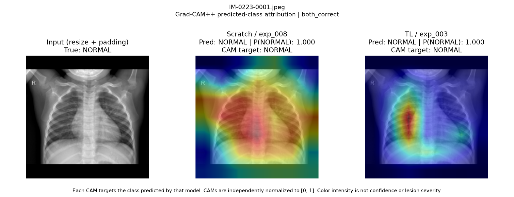
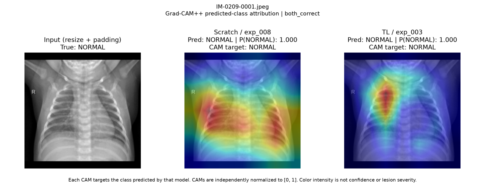
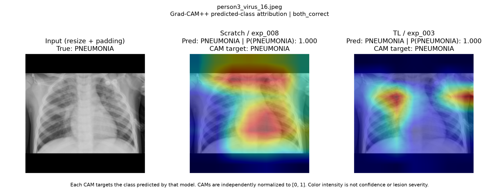

# Grad-CAM++ 분석

## 1. 목적

본 분석의 목적은 대표 Scratch 모델과 Transfer Learning 모델이 동일한 Chest X-ray를 분류할 때 **어떤 영역을 판단 근거로 사용하는지 비교**하는 것이다.

분류 성능이 유사하거나 동일한 정답을 예측하더라도 두 모델이 같은 visual feature를 활용한다고 볼 수는 없다.

따라서 Grad-CAM++을 이용해 각 모델이 실제로 예측한 class에 대한 heatmap을 생성하고, 두 모델의 spatial pattern을 비교한다.

---

## 2. 비교 모델

Validation F1을 기준으로 사전에 선택한 representative model을 사용한다.

```text
Scratch           : exp_008
Transfer Learning : exp_003
Architecture      : ResNet-50
```

대표 모델 선택에는 Test 결과를 사용하지 않았다.

---

## 3. Grad-CAM++ 설정

```text
Method       : Grad-CAM++
Target Layer : layer4[-1]
Target Score : pre-softmax predicted-class logit
```

ResNet-50의 마지막 convolutional block인 `layer4[-1]`을 target layer로 사용한다.

두 모델에는 동일한 Test image와 동일한 preprocessing 결과를 입력한다.

---

## 4. Predicted-class Target

초기 구현에서는 Grad-CAM++ target을 항상 `PNEUMONIA`로 고정했다.

하지만 이 방식은 모델이 `NORMAL`을 예측한 경우, 실제 NORMAL 예측의 근거가 아니라 PNEUMONIA logit에 대한 heatmap을 보여준다.

따라서 최종 구현에서는 각 모델이 실제로 예측한 class를 Grad-CAM++ target으로 사용한다.

```text
Predicted NORMAL
→ Grad-CAM++ target: NORMAL

Predicted PNEUMONIA
→ Grad-CAM++ target: PNEUMONIA
```

예를 들어:

```text
Pred: NORMAL | P(NORMAL): 0.999
CAM target: NORMAL
```

은 모델이 NORMAL을 예측했으며, heatmap은 NORMAL logit을 증가시키는 데 기여한 영역을 나타낸다.

반대로:

```text
Pred: PNEUMONIA | P(PNEUMONIA): 1.000
CAM target: PNEUMONIA
```

은 PNEUMONIA prediction에 대한 heatmap을 의미한다.

Evaluation에서는 `PNEUMONIA`를 positive class로 정의하지만, 이는 Grad-CAM++ target 설정과는 별개의 개념이다.

---

## 5. Test Sample 선택

Grad-CAM++ sample은 최종 Test split에서 선택한다.

CSV의 원래 정렬 순서가 NORMAL과 PNEUMONIA를 구분해 배치할 수 있으므로 단순히 앞에서부터 sample을 선택하지 않는다.

대신 class-balanced random sampling을 사용한다.

기본 설정:

```text
NORMAL      : 5 images
PNEUMONIA   : 5 images
Total       : 10 images
Random Seed : 42
```

Random seed를 고정하므로 동일한 seed를 사용하면 동일한 image subset이 선택된다.

실행 예:

```bash
python scripts/compare_gradcam.py
```

다른 seed:

```bash
python scripts/compare_gradcam.py --seed 123
```

20장 선택:

```bash
python scripts/compare_gradcam.py --num_images 20 --seed 123
```

특정 Test image를 직접 지정할 수도 있다.

```bash
python scripts/compare_gradcam.py --filename <filename>
```

---

## 6. 결과 이미지 구성

각 sample마다 하나의 비교 figure를 생성한다.

```text
Input
Scratch Grad-CAM++
Transfer Learning Grad-CAM++
```

각 모델 panel에는 다음 정보를 표시한다.

- predicted class
- predicted-class probability
- CAM target

예:

```text
Scratch / exp_008
Pred: NORMAL | P(NORMAL): 1.000
CAM target: NORMAL
```

또는:

```text
TL / exp_003
Pred: PNEUMONIA | P(PNEUMONIA): 0.998
CAM target: PNEUMONIA
```

각 CAM은 모델별·이미지별로 독립적으로 `[0, 1]` 범위로 normalization한다.

따라서 서로 다른 CAM의 색 강도를 직접 비교해 confidence 또는 lesion severity 차이라고 해석하지 않는다.

---

## 7. Prediction Category

두 모델의 정답 여부에 따라 sample을 다음과 같이 분류한다.

```text
both_correct
scratch_only_correct
transfer_only_correct
both_wrong
```

예를 들어 실제 label이 NORMAL이고 두 모델 모두 NORMAL을 예측했다면:

```text
True       : NORMAL
Scratch    : NORMAL
Transfer   : NORMAL
Category   : both_correct
```

반대로 실제 label이 PNEUMONIA인데 두 모델 모두 NORMAL을 예측했다면 `both_wrong`에 해당한다.

---

## 8. Grad-CAM++ 비교 결과

### 기존 실험의 비교 그림

다음 세 그림은 **seed=123으로 선택한 20장 class-balanced random Test 표본 중 일부**다. 그림은 기존 Grad-CAM++ 분석 결과이며, 코드 기본 설정인 seed=42·10장 표본과 구분한다.

**NORMAL — `IM-0223-0001.jpeg` (both_correct)**



**NORMAL — `IM-0209-0001.jpeg` (both_correct)**



**PNEUMONIA — `person3_virus_16.jpeg` (both_correct)**



세 그림 모두 각각의 정답 class를 두 모델이 예측한 예시다. 각각 Scratch `exp_008`, Transfer `exp_003`으로 그림에 기록되어 있고, predicted-class CAM을 보여준다. 색 강도는 모델별 독립 정규화 결과이므로 직접 비교하지 않는다. 정량적 경향, 임상적 병변 위치, shortcut 사용의 인과성은 입증하지 않는다. 표본 filename, 체크포인트 SHA-256 및 실행 조건은 [Grad-CAM++ 실행 기록](assets/gradcam/README.md)에 정리했다.


여러 Test sample을 비교한 결과, 두 모델이 동일한 정답을 예측하더라도 heatmap의 spatial pattern에는 차이가 나타났다.

### Scratch

일부 sample에서 다음과 같은 영역까지 넓게 반응했다.

- 영상 상단 및 하단 경계
- 검은 padding 인접 영역
- 폐야 외부
- 횡격막 주변 및 흉곽 바깥쪽
- 넓고 diffuse한 activation

### Transfer Learning

상대적으로 다음과 같은 패턴이 더 자주 나타났다.

- 폐야 내부의 제한된 영역
- 흉곽 내부
- Scratch보다 더 국소적인 activation

이 차이는 두 모델이 모두 정답을 맞힌 sample에서도 관찰되었다.

즉 같은 classification output이 반드시 같은 visual evidence를 의미하지는 않는다.

---

## 9. Shortcut-like Feature 가능성

Scratch 모델에서 영상 경계, padding 인접 영역 및 폐야 외부 반응이 반복적으로 나타난 것은 **dataset-specific shortcut-like feature에 대한 의존 가능성**을 시사한다.

가능한 비병변적 visual cue에는 다음과 같은 요소가 있다.

- Image borders
- Padding geometry
- Crop / positioning 차이
- Radiographic markers
- Text
- Acquisition/device-related artifacts
- Resolution 또는 aspect ratio 차이
- Dataset-specific visual patterns

특히 본 프로젝트는 aspect ratio를 보존하기 위해 검은 padding을 사용하므로, 원본 영상의 크기나 종횡비가 class와 상관되어 있다면 padding 형태 자체가 잠재적인 shortcut cue가 될 가능성도 고려할 수 있다.

다만 현재 결과는 정성적 비교에 기반한 가설 수준이며, padding 또는 특정 artifact가 실제 prediction에 causal하게 사용되었다는 것을 입증하지 않는다.

---

## 10. Transfer Learning과의 차이

Transfer Learning 모델은 ImageNet pretrained feature를 기반으로 학습을 시작한다.

현재 확인한 Test sample의 Grad-CAM++에서는 Scratch보다 폐야 내부에 heatmap이 더 국소화되는 사례가 상대적으로 자주 나타났다.

이는 pretrained feature가 Scratch와 다른 representation을 형성했을 가능성과 일관된 관찰이지만, 현재 결과만으로 그 원인을 ImageNet pretraining으로 직접 귀속할 수는 없다.

따라서 다음과 같이 해석한다.

> Scratch와 Transfer Learning은 유사한 분류 결과를 보이더라도 서로 다른 spatial pattern을 형성할 수 있으며, 현재 sample에서는 Transfer Learning이 상대적으로 폐야 내부의 제한된 영역에 더 집중하는 경향이 관찰되었다.

---

## 11. 저장 결과

> **Grad-CAM++ 결과 공개 범위:** 기존 실험의 비교 PNG 3개와 실행 manifest를 공개 자료로 보존한다. 실제 실행은 seed=123, 총 20개 class-balanced Test 표본을 사용했다. Scratch/Transfer 체크포인트의 SHA-256은 manifest에 기록되어 있다. 20개 표본의 예측 기록은 manifest에 보존하며, 이 문서에는 3개 사례를 시각화한다.


Grad-CAM++ 실행 결과는 다음 위치에 저장된다.

```text
results/gradcam/<timestamp>/
├── XXXX_image.png
├── XXXX_image_cams.npz
└── manifest.json
```

### PNG

다음을 포함한 비교 figure를 저장한다.

```text
Input
Scratch Grad-CAM++
Transfer Learning Grad-CAM++
```

### NPZ

Scratch와 Transfer Learning의 raw CAM array를 저장한다.

```text
scratch
transfer
```

향후 필요할 경우 CAM overlap, spatial concentration 또는 lung-region attribution 등의 정량 분석에 사용할 수 있다.

### manifest.json

다음 정보를 기록한다.

- selected image
- true label
- prediction
- predicted-class probability
- CAM target
- correctness
- category
- checkpoint path
- checkpoint SHA-256
- CSV path
- CSV SHA-256
- library versions
- random seed
- sampling configuration

자동 생성되는 `results/gradcam/`은 Git repository에 포함하지 않는다.

---

## 12. 해석할 때 주의할 점

Grad-CAM++는 post-hoc attribution method이다.

따라서 다음과 같이 해석하지 않는다.

- Heatmap이 실제 병변을 정확히 localization했다고 단정
- 붉은 영역이 더 강하므로 모델 confidence가 더 높다고 해석
- 붉은 영역이 실제 lesion severity를 의미한다고 해석
- 특정 heatmap만으로 shortcut learning을 확정
- Grad-CAM++ 결과를 clinical explanation으로 해석

각 CAM은 독립적으로 normalization되므로 서로 다른 모델 또는 서로 다른 sample 사이의 절대 색 강도를 직접 비교할 수 없다.

또한 NORMAL class heatmap은 특정한 "정상 병변"을 찾는 것이 아니라 NORMAL logit에 기여한 영역을 나타낸다.

---

## 13. 미수행 정량 분석 (후속 개발 범위 아님)

본 프로젝트에서는 정성적 이미지 비교까지만 수행했다. Lung segmentation mask를 이용한 정량 분석과 padding 개입 실험은 수행하지 않았으며, 종료 후 추가 구현 계획으로 포함하지 않는다. 예컨대 다른 연구에서는 다음과 같은 지표를 검토할 수 있다.

```text
CAM energy inside lung / total CAM energy
```

또는:

- lung-region attribution ratio
- outside-lung attribution ratio
- CAM spatial concentration
- Scratch / Transfer CAM overlap
- correct / incorrect prediction 간 차이

이러한 정량 분석을 추가하면 shortcut-like feature 의존 가능성을 보다 체계적으로 검토할 수 있다.

---

## 14. 결론

Grad-CAM++ 분석 결과, Scratch와 Transfer Learning은 동일한 Chest X-ray에서 동일한 class를 예측하더라도 서로 다른 heatmap pattern을 보일 수 있음을 확인했다.

현재 확인한 여러 Test sample에서 Scratch는 일부 사례에서 영상 경계, padding 인접 영역 및 폐야 외부까지 넓게 반응했다.

Transfer Learning은 상대적으로 폐야 내부의 제한된 영역에 집중하는 사례가 더 자주 나타났다.

이는 Scratch 모델의 shortcut-like visual feature 의존 가능성을 시사하지만, Grad-CAM++만으로 shortcut learning을 확정하지 않는다.

따라서 본 프로젝트에서는 Grad-CAM++를 모델 판단 근거를 비교하기 위한 도구로 사용하며, 임상적 병변 localization 또는 causal explanation의 근거로 해석하지 않는다.
